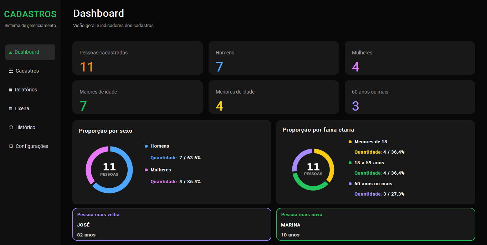
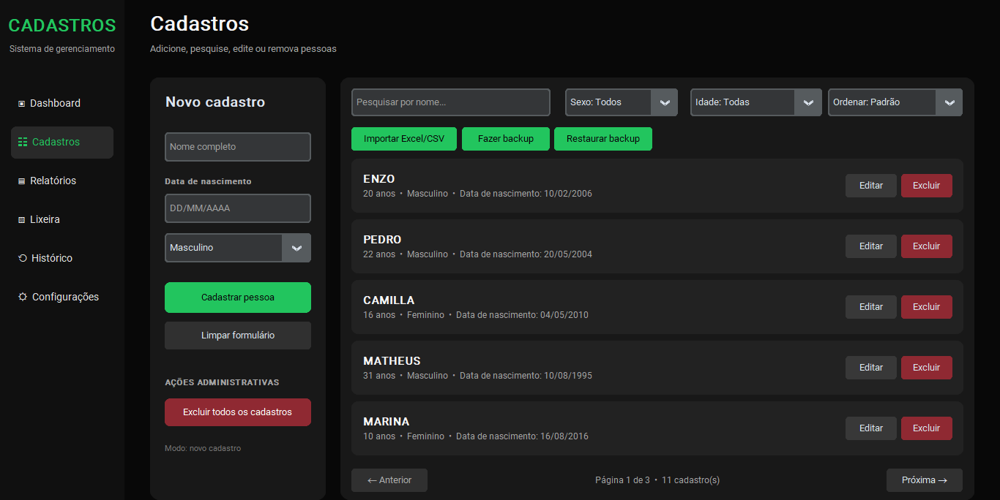
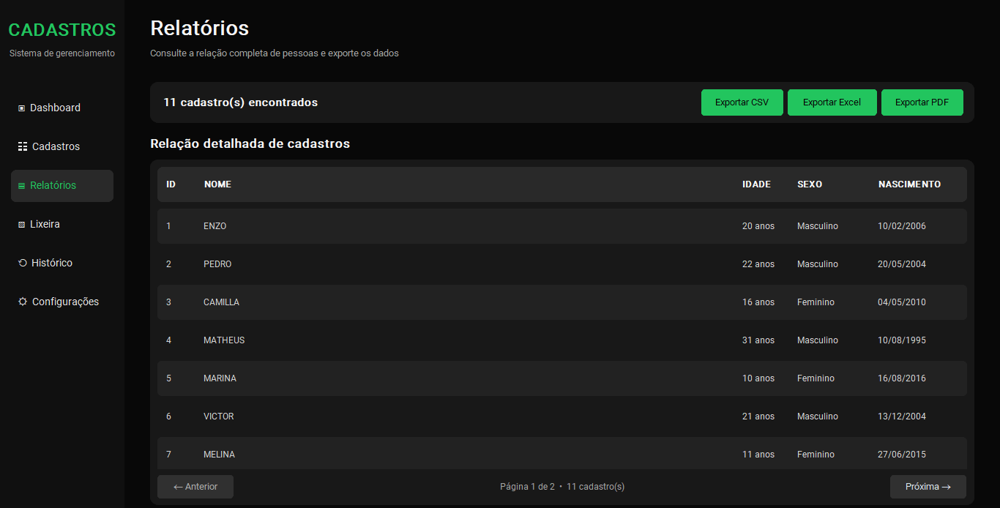
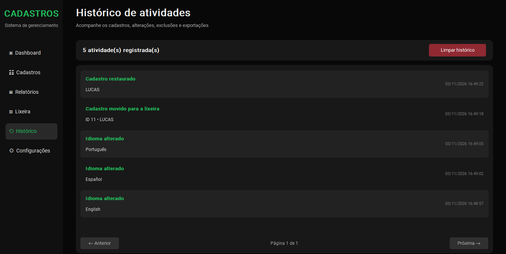
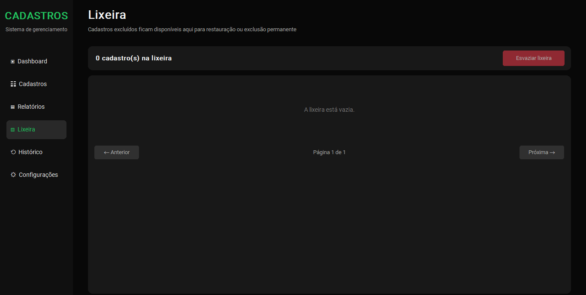

# Sistema de Cadastros

Aplicativo desktop para gerenciamento de pessoas, desenvolvido em **Python** com **CustomTkinter**. O sistema permite cadastrar, consultar, editar e organizar informações por meio de uma interface gráfica moderna, com tema escuro e recursos de gerenciamento de dados.

## Demonstração do sistema

### Dashboard

Painel principal com indicadores estatísticos, gráficos de rosca para distribuição por sexo e faixa etária, além dos destaques da pessoa mais velha e da mais nova.



### Cadastro de pessoas

Tela de gerenciamento com formulário de cadastro, listagem de pessoas, pesquisa, filtros, ordenação e paginação.



### Relatórios

Visualização dos registros cadastrados e opções de exportação para CSV, Excel e PDF.



### Histórico de atividades

Registro das operações realizadas no sistema, com informações de data e horário.



### Lixeira

Área destinada ao gerenciamento de cadastros excluídos, permitindo restaurar registros ou realizar a exclusão permanente.



### Configurações

Área para personalização das preferências do sistema, incluindo a seleção de idioma.


## Funcionalidades

### Cadastro e gerenciamento de pessoas

- Cadastro de pessoas com nome, data de nascimento e sexo.
- Entrada de data de nascimento com máscara automática no formato DD/MM/AAAA.
- Cálculo automático da idade com base na data de nascimento.
- Atualização da idade conforme a passagem do tempo.
- Edição e exclusão de cadastros.
- Exclusão de todos os registros mediante confirmação.
- Pesquisa por nome.
- Filtros por sexo e faixa etária.
- Ordenação dos registros.
- Paginação para organização dos cadastros.

### Dashboard

- Indicadores de pessoas cadastradas, homens, mulheres, maiores de idade, menores de idade e pessoas com 60 anos ou mais.
- Gráfico de rosca com a proporção por sexo.
- Gráfico de rosca com a proporção por faixa etária.
- Exibição de quantidades e percentuais nos gráficos.
- Destaques para a pessoa mais velha e a pessoa mais nova.
- Atualização dos indicadores e gráficos conforme os dados dos cadastros.

### Relatórios e exportação

- Relatórios detalhados dos cadastros.
- Visualização organizada dos registros.
- Paginação dos resultados.
- Exportação para CSV.
- Exportação para Excel.
- Exportação para PDF.

### Importação, backup e recuperação

- Importação de cadastros por arquivos CSV e Excel.
- Validação dos dados importados.
- Criação de backups dos dados.
- Restauração de dados a partir de backups.
- Lixeira para gerenciamento de registros excluídos.
- Restauração de cadastros removidos.
- Exclusão permanente de registros.
- Opção para esvaziar a lixeira.

### Histórico e configurações

- Histórico de atividades com data e horário.
- Opção para limpar o histórico.
- Interface disponível em português, inglês e espanhol.
- Preferência de idioma salva localmente.

## Tecnologias utilizadas

- **Python 3.10+** — linguagem principal.
- **CustomTkinter** — desenvolvimento da interface gráfica.
- **Matplotlib** — criação dos gráficos do Dashboard.
- **OpenPyXL** — manipulação de arquivos Excel.
- **ReportLab** — geração de relatórios em PDF.
- **JSON** — armazenamento local dos dados.
- **CSV** — importação e exportação de informações.

O projeto também utiliza bibliotecas nativas do Python, como `json`, `csv`, `datetime`, `pathlib` e `re`.

## Requisitos

- Python 3.10 ou superior.
- Pip.

## Como executar

1. Clone o repositório:

   ```bash
   git clone https://github.com/matheus-santana-dev/sistema-cadastros.git
   ```

2. Entre na pasta do projeto:

   ```bash
   cd sistema-cadastros
   ```

3. Crie um ambiente virtual (opcional, recomendado):

   ```bash
   python -m venv .venv
   ```

4. Ative o ambiente virtual no Windows:

   ```powershell
   .venv\Scripts\activate
   ```

5. Instale as dependências:

   ```bash
   python -m pip install -r requirements.txt
   ```

6. Execute o sistema:

   ```bash
   python main.py
   ```

## Armazenamento dos dados

O sistema utiliza arquivos JSON para armazenar os cadastros e informações auxiliares localmente.

O arquivo principal de pessoas fica em:

```text
data/pessoas.json
```

Outros arquivos auxiliares são utilizados para armazenar histórico de atividades, configurações e informações da lixeira.

Os backups são gerados em formato JSON no local escolhido durante a operação.

**Observação:** os registros disponibilizados no repositório são fictícios e utilizados exclusivamente para demonstração do projeto.

Recomenda-se manter cópias de segurança dos dados antes de realizar alterações importantes.

## Estrutura do projeto

```text
sistema-cadastros/
│
├── app/
│   ├── __init__.py
│   ├── database.py
│   ├── services.py
│   ├── ui.py
│   ├── validators.py
│   ├── configuracoes.json
│   ├── dados_nascimento.json
│   ├── historico_atividades.json
│   └── lixeira_cadastros.json
│
├── data/
│   └── pessoas.json
│
├── screenshots/
│   ├── dashboard.png
│   ├── cadastros.png
│   ├── relatorios.png
│   ├── historico.png
│   ├── lixeira.png
│   └── configuraçoes.png
│
├── main.py
├── requirements.txt
├── README.md
└── .gitignore
```

## Objetivo do projeto

Projeto desenvolvido para praticar e demonstrar conhecimentos em desenvolvimento com Python, aplicando conceitos e recursos utilizados na construção de aplicações desktop.

Entre os principais conceitos trabalhados estão:

- Programação modular.
- Construção de interfaces gráficas.
- Operações CRUD (criar, consultar, atualizar e excluir).
- Validação e tratamento de dados.
- Persistência local com JSON.
- Manipulação de datas e cálculo automático de idade.
- Importação e exportação de arquivos.
- Geração de relatórios.
- Visualização de dados com gráficos.
- Backup e restauração de informações.

## Autor

**Matheus Santana Costa Leite**

- GitHub: [matheus-santana-dev](https://github.com/matheus-santana-dev)